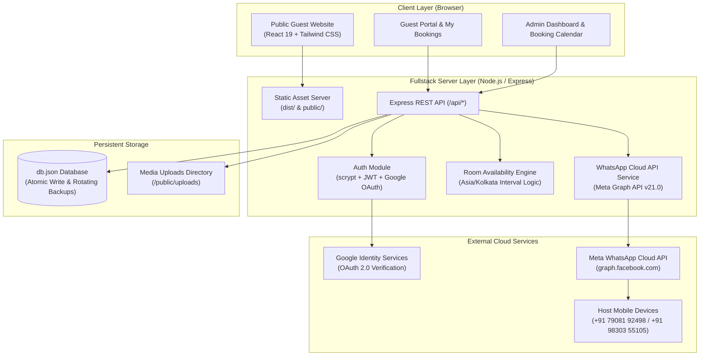

# 🏔️ Mineral Springs Retreat
### Authentic Himalayan Eco-Stay · Dawaipani, Darjeeling
[](https://nodejs.org/)
[](https://react.dev/)
[](https://tailwindcss.com/)
[](https://developers.facebook.com/docs/whatsapp/cloud-api)
[](https://developers.google.com/identity/protocols/oauth2)
[](#license)

A full-stack, luxury boutique hospitality website and property management system engineered for **Mineral Springs Retreat**, perched at 6,500 feet in the peaceful Himalayan hamlet of Dawaipani opposite Darjeeling, West Bengal.

The application combines a high-performance, editorial public web presence with a comprehensive property management dashboard, real-time booking calendar, automated Meta WhatsApp host notifications, Google guest authentication, and an atomic persistent database.

---

## 📑 Table of Contents
1. [Key Features](#-key-features)
2. [System Architecture](#-system-architecture)
3. [Technology Stack](#-technology-stack)
4. [Quick Start & Local Development](#-quick-start--local-development)
5. [Administrative Dashboard](#-administrative-dashboard)
6. [Production Deployment Guide](#-production-deployment-guide)
   - [Option 1: Render (Recommended)](#option-1-render-recommended-fullstack--persistent-disk)
   - [Option 2: Railway](#option-2-railway-fullstack--volume-mount)
   - [Option 3: Docker & Docker Compose](#option-3-docker--docker-compose-any-vps--cloud)
   - [Option 4: Linux VPS (Ubuntu / Nginx / PM2 / SSL)](#option-4-linux-vps-ubuntu--nginx--pm2--lets-encrypt-ssl)
   - [Option 5: Decoupled (Vercel + Backend)](#option-5-decoupled-deployment-vercel-frontend--render-backend)
7. [Environment Variables Reference](#-environment-variables-reference)
8. [Meta WhatsApp Cloud API Configuration](#-meta-whatsapp-cloud-api-configuration)
9. [Google OAuth 2.0 Setup](#-google-oauth-20-setup)
10. [Security & Backup Procedures](#-security--backup-procedures)

---

## ✨ Key Features

### 🌐 Public Guest Website
- **Luxury Editorial Design:** Custom mountain aesthetic with Deep Forest Pine (`#17251D`), Champagne Gold (`#B89A70`), and Warm Cream (`#FAF7F2`) accents.
- **Typography System:** Cormorant Garamond editorial serif paired with DM Sans and Lato body text.
- **Responsive Parity:** Verified responsive layout across mobile (360px, 390px), tablet (768px), and desktop (1024px–1920px). Zero horizontal scroll overflow.
- **Hero & Storytelling:** Full-width Himalayan panoramic vistas overlooking Mount Kanchenjunga and the historic Lebong tea gardens.
- **Room Showcase:** Dedicated accommodation profiles with daily tariffs (all 4 daily homemade meals included), amenities grid, and high-resolution galleries.
- **Village & Travel Guide:** Altitude warnings, transit metrics from Siliguri/Bagdogra/NJP, and local mountain trail activities.

### 🛎️ Guest Booking & Google OAuth 2.0
- **Google One-Tap / OAuth 2.0:** Secure guest authentication linked to stable Google Account IDs (`sub`). No custom passwords required for guests.
- **Reservation Engine:** Interactive night counter, guest count multiplier, automatic meal inclusion calculations, and special request capture.
- **Guest Self-Service Drawer ("My Bookings"):** Real-time booking history, status badges, stay date modification, and guest-initiated cancellations.

### 📅 Booking Calendar & Room Inventory Engine
- **4 Comprehensive Views:**
  - **Monthly View:** 30/31-day interactive grid with room availability chips (`2/2 free`, `1/2 free`, `Sold Out`) and multi-day stay pills (`↳ IN`, stay, `↲ OUT`).
  - **Weekly View:** 7-day multi-column timeline display.
  - **Daily View:** 4 KPI counters and an **Accommodation Inventory Matrix** showing individual unit occupancy (Unit 1 & Unit 2) for each room type.
  - **List View:** Sortable, filterable table of all reservations.
- **Overlap Protection:** Server-side date interval verification (`[checkIn, checkOut)`) that prevents accidental double bookings while properly allowing check-in on the exact date an outgoing guest departs.
- **Status Color Palette:**
  - 🟡 **Pending:** Yellow (`bg-amber-100`)
  - 🟢 **Confirmed:** Green (`bg-emerald-100`)
  - 🔴 **Cancelled:** Red (`bg-rose-100`, inventory released immediately)
  - ⚪ **Completed:** Grey (`bg-neutral-100`)
- **Asia/Kolkata Timezone (IST):** Native timezone calculation across all calendar dates.

### 📱 Automated WhatsApp Notifications
- **Official Meta WhatsApp Cloud API (Graph API v21.0):** Dispatches instant alerts strictly server-side directly to the host's mobile phone.
- **Tri-Event Lifecycle Coverage:** Dispatches on **New Reservations**, **Booking Modifications**, and **Booking Cancellations**.
- **Admin WhatsApp Dashboard:** Live interactive chat bubble mockup, host phone configuration, delivery audit table, test alert trigger, and manual resend button.
- **Idempotency Protection:** Event-level flags prevent redundant messages.

### 🛡️ Administrative Dashboard & CMS
- **Role-Based Access Control (RBAC):** Super Admin, Admin, Manager, and Staff roles with scrypt password hashing and unique random salts.
- **Website Content CMS:** Live drafting, visual preview mode, and one-click publishing for all website text, tariffs, and hero images.
- **Media Library:** Image uploader with category tagging and media manager.
- **Inquiry Management:** Centralized reservations dashboard with CSV export, staff audit notes, and status workflows.

---

## 🏛️ System Architecture



---

## 💻 Technology Stack

| Layer | Technologies |
|---|---|
| **Frontend Framework** | React 18.3 / 19, Vite 6 |
| **Styling & Icons** | Tailwind CSS v3.4 / v4, Lucide React |
| **Typography** | Cormorant Garamond, DM Sans, Lato, Cinzel, Playfair Display |
| **Animations** | GSAP, ScrollTrigger, CSS3 Keyframes |
| **Backend Framework** | Node.js (ES Modules), Express.js 4.21 |
| **Database** | Persistent JSON (`db.json`) with atomic file locking and backup rotation |
| **Authentication** | Node.js `crypto.scryptSync` (16-byte random salts) + JWT session tokens |
| **Guest Authentication** | Google OAuth 2.0 (Google Identity Services) |
| **Messaging Integration** | Meta WhatsApp Business Cloud API (`graph.facebook.com/v21.0`) |
| **Containerization** | Multi-stage Alpine Dockerfile, Docker Compose |
| **Hosting Compatibility** | Render, Railway, Fly.io, DigitalOcean, AWS, any Linux VPS |

---

## 🚀 Quick Start & Local Development

### 1. Prerequisites
- Node.js 18.x or 20.x+
- npm 9.x+
- Git

### 2. Clone and Install
```bash
git clone https://github.com/santrarony9/mineral-springs-retreat.git
cd mineral-springs-retreat

# Install dependencies
npm install
```

### 3. Setup Environment Variables
```bash
# Copy example configuration
cp .env.example .env
```
*(In local development, the system runs in simulation mode with sensible defaults even if third-party credentials are placeholders.)*

### 4. Run Development Servers
```bash
# Runs both Express backend (port 5000) and Vite frontend (port 3000) concurrently
npm run dev
```

### 5. Run Fullstack Production Locally
```bash
# Compile production frontend bundle
npm run build

# Start Express fullstack server
npm start
```
- **Live Website:** [http://localhost:5000](http://localhost:5000)
- **Admin Dashboard:** [http://localhost:5000/admin](http://localhost:5000/admin)

---

## 🔐 Administrative Dashboard

- Access URL: `https://your-domain.com/admin` (or `http://localhost:5000/admin`)
- Default Super Admin account:
  - **Username:** `admin`
  - **Password:** Configured during initial setup (can be changed anytime in the Admin Dashboard under **Security & Logs**).

---

## 🌐 Production Deployment Guide

Because Mineral Springs Retreat is a fullstack application with a persistent database (`db.json`) and uploaded media storage (`/public/uploads`), choose a hosting platform that supports a persistent filesystem or volume mount:

---

### Option 1: Render (Recommended Fullstack + Persistent Disk)

Render provides zero-maintenance Node.js hosting with automated SSL, custom domains, and persistent SSD storage.

#### Step-by-Step Render Setup:
1. Fork or push this repository to your GitHub account (`https://github.com/santrarony9/mineral-springs-retreat`).
2. Log in to [Render.com](https://render.com) and click **New +** &rarr; **Web Service**.
3. Select your GitHub repository `mineral-springs-retreat`.
4. Configure the Web Service:
   - **Name:** `mineral-springs-retreat`
   - **Region:** `Singapore` (or nearest to your guests)
   - **Branch:** `main`
   - **Runtime:** `Node`
   - **Build Command:** `npm install && npm run build`
   - **Start Command:** `npm start`
   - **Plan:** `Starter` (supports Persistent Disks)
5. Under **Disks**, click **Add Disk**:
   - **Name:** `msr-data`
   - **Mount Path:** `/app/server/data`
   - **Size:** `1 GB`
6. Under **Environment Variables**, add the keys from your `.env.example`:
   - `NODE_ENV`: `production`
   - `PORT`: `10000`
   - `CLIENT_URL`: `https://mineral-springs-retreat.onrender.com` (or your custom domain)
   - `SESSION_SECRET`: *(Generate a random 32-character string)*
   - `WHATSAPP_NOTIFICATIONS_ENABLED`: `true`
   - `WHATSAPP_HOST_PHONE`: `+917908192498`
   - `WHATSAPP_PHONE_NUMBER_ID`: `your-meta-phone-number-id`
   - `WHATSAPP_ACCESS_TOKEN`: `your-meta-access-token`
   - `WHATSAPP_BUSINESS_ACCOUNT_ID`: `your-meta-business-account-id`
   - `GOOGLE_CLIENT_ID`: `your-google-oauth-client-id`
   - `GOOGLE_CLIENT_SECRET`: `your-google-oauth-client-secret`
7. Click **Create Web Service**. Render will automatically build the React bundle and boot the Express backend with free automated HTTPS!

---

### Option 2: Railway (Fullstack + Volume Mount)

1. Log in to [Railway.app](https://railway.app).
2. Click **New Project** &rarr; **Deploy from GitHub repo** &rarr; select `mineral-springs-retreat`.
3. Go to **Settings** &rarr; **Volumes** &rarr; click **Add Volume**:
   - **Mount Path:** `/app/server/data`
4. In **Variables**, enter your environment variables from `.env.example`.
5. Railway automatically detects the `Procfile` or `package.json` build/start scripts and provides a public HTTPS domain.

---

### Option 3: Docker & Docker Compose (Any VPS / Cloud)

Deploy to any Linux server (DigitalOcean Droplet, AWS EC2, Linode, Hetzner, etc.) using Docker:

```bash
# 1. Clone repository on server
git clone https://github.com/santrarony9/mineral-springs-retreat.git
cd mineral-springs-retreat

# 2. Configure production .env
cp .env.example .env
nano .env

# 3. Build and launch container in detached mode
docker compose up -d --build

# 4. Check status and logs
docker compose ps
docker compose logs -f
```
The website will be running on port `5000` with automated health checks and persistent volume storage.

---

### Option 4: Linux VPS (Ubuntu + Nginx + PM2 + Let's Encrypt SSL)

For maximum performance on an Ubuntu 22.04 / 24.04 LTS server:

#### 1. Server Preparation
```bash
sudo apt update && sudo apt upgrade -y
sudo apt install -y nodejs npm nginx git certbot python3-certbot-nginx
sudo npm install -g pm2
```

#### 2. Deploy Project
```bash
sudo mkdir -p /var/www/mineral-springs-retreat
sudo chown -R $USER:$USER /var/www/mineral-springs-retreat
git clone https://github.com/santrarony9/mineral-springs-retreat.git /var/www/mineral-springs-retreat
cd /var/www/mineral-springs-retreat

cp .env.example .env
nano .env

npm install
npm run build
```

#### 3. Start with PM2 Process Manager
```bash
pm2 start server/index.js --name "mineral-springs-retreat"
pm2 save
pm2 startup
```

#### 4. Configure Nginx Reverse Proxy
Create `/etc/nginx/sites-available/mineralsprings`:
```nginx
server {
    server_name yourdomain.com www.yourdomain.com;

    client_max_body_size 25M;

    location / {
        proxy_pass http://127.0.0.1:5000;
        proxy_http_version 1.1;
        proxy_set_header Upgrade $http_upgrade;
        proxy_set_header Connection 'upgrade';
        proxy_set_header Host $host;
        proxy_cache_bypass $http_upgrade;
        proxy_set_header X-Forwarded-For $proxy_add_x_forwarded_for;
        proxy_set_header X-Forwarded-Proto $scheme;
    }
}
```

```bash
sudo ln -s /etc/nginx/sites-available/mineralsprings /etc/nginx/sites-enabled/
sudo nginx -t
sudo systemctl reload nginx
```

#### 5. Issue Free Let's Encrypt SSL Certificate
```bash
sudo certbot --nginx -d yourdomain.com -d www.yourdomain.com
```

---

### Option 5: Decoupled Deployment (Vercel Frontend + Render Backend)

If you prefer serving the static frontend on Vercel's global CDN:
1. Deploy the backend Express server to Render or Railway as detailed in Option 1.
2. In `vite.config.js`, set `server.proxy` or point `api` requests to your live backend domain (e.g. `https://api.yourdomain.com`).
3. Deploy the repository to Vercel with Framework Preset **Vite**, Build Command `npm run build`, and Output Directory `dist`.

---

## ⚙️ Environment Variables Reference

| Variable | Required | Default | Description |
|---|:---:|---|---|
| `PORT` | Yes | `5000` | Port on which the Express server listens |
| `NODE_ENV` | Yes | `production` | Set to `production` in live environments |
| `CLIENT_URL` | Yes | `http://localhost:5000` | Full canonical URL of the live website |
| `SESSION_SECRET` | Yes | *(Random Salt)* | Secret key used for signing JWT tokens and salts |
| `GOOGLE_CLIENT_ID` | Optional | Placeholder | Google Cloud OAuth 2.0 Web Client ID |
| `GOOGLE_CLIENT_SECRET` | Optional | Placeholder | Google Cloud OAuth 2.0 Web Client Secret |
| `GOOGLE_CALLBACK_URL` | Optional | `/api/auth/google/callback` | OAuth redirect callback URL |
| `WHATSAPP_NOTIFICATIONS_ENABLED` | Yes | `true` | Master switch for automated host WhatsApp notifications |
| `WHATSAPP_HOST_PHONE` | Yes | `+917908192498` | Registered WhatsApp recipient phone with country code |
| `WHATSAPP_PHONE_NUMBER_ID` | Optional | Placeholder | Meta Cloud API Phone Number ID |
| `WHATSAPP_ACCESS_TOKEN` | Optional | Placeholder | Meta System User permanent Access Token |
| `WHATSAPP_BUSINESS_ACCOUNT_ID` | Optional | Placeholder | Meta WhatsApp Business Account ID |
| `WHATSAPP_API_VERSION` | Yes | `v21.0` | Meta Graph API Version |

---

## 📲 Meta WhatsApp Cloud API Configuration

To enable automated WhatsApp notifications directly to the host's physical mobile device:
1. Register at [Meta for Developers](https://developers.facebook.com/).
2. Create a **Business App** and add the **WhatsApp** product.
3. In **WhatsApp &rarr; API Setup**:
   - Note your **Phone Number ID** and **WhatsApp Business Account ID**.
   - Add your host phone numbers (`+91 79081 92498` / `+91 98303 55105`) to the verified recipients.
4. In **Business Settings &rarr; System Users**:
   - Create a System User with Admin permissions.
   - Generate a permanent token with `whatsapp_business_messaging` and `whatsapp_business_management` permissions.
5. In the Admin Dashboard (`/admin`), go to **WHATSAPP ALERTS**, enter your credentials, and click **Save Settings**.
6. Click **Send Test Alert** to verify physical delivery!

---

## 🔑 Google OAuth 2.0 Setup

To enable guest and owner sign-in with Google:
1. Open the [Google Cloud Console Credentials](https://console.cloud.google.com/apis/credentials).
2. Select your OAuth Client ID (or create one for Web Application):
   `465876529150-ttmo87mj8jdi1n4lh8u9e6uoqa6j133n.apps.googleusercontent.com`
3. Under **Authorized JavaScript origins**, add:
   - `https://mineralspringretreat.com`
   - `https://www.mineralspringretreat.com`
   - `https://mineral-springs-retreat.vercel.app`
   - `http://localhost:3000`
   - `http://localhost:5000`
4. Under **Authorized redirect URIs**, add:
   - `https://mineralspringretreat.com/api/auth/google/callback`
   - `https://www.mineralspringretreat.com/api/auth/google/callback`
   - `https://mineral-springs-retreat.vercel.app/api/auth/google/callback`
   - `http://localhost:5000/api/auth/google/callback`
5. Configure the Client ID and Client Secret in Vercel environment variables or local `.env`.

---

## 🛡️ Security & Backup Procedures

1. **Password Encryption:** Native `crypto.scryptSync` with unique 16-byte random salts. Plaintext passwords are never stored.
2. **Stateless JWT Sessions:** Protected with cryptographic signing and expiration tracking.
3. **Automated Database Backups:** The JSON database layer automatically rotates hourly and daily snapshots to `server/data/backups/`.
4. **Credential Masking:** All API keys and secrets are masked in administrative JSON responses.
5. **No Secret Commits:** `.gitignore` strictly prevents committing `.env`, temporary files, and runtime backups.

---

## 📄 License & Credits
© 2026 Mineral Springs Retreat. All rights reserved.  
Photography and typography assets curated for Mineral Springs Retreat, Dawaipani, Darjeeling.
